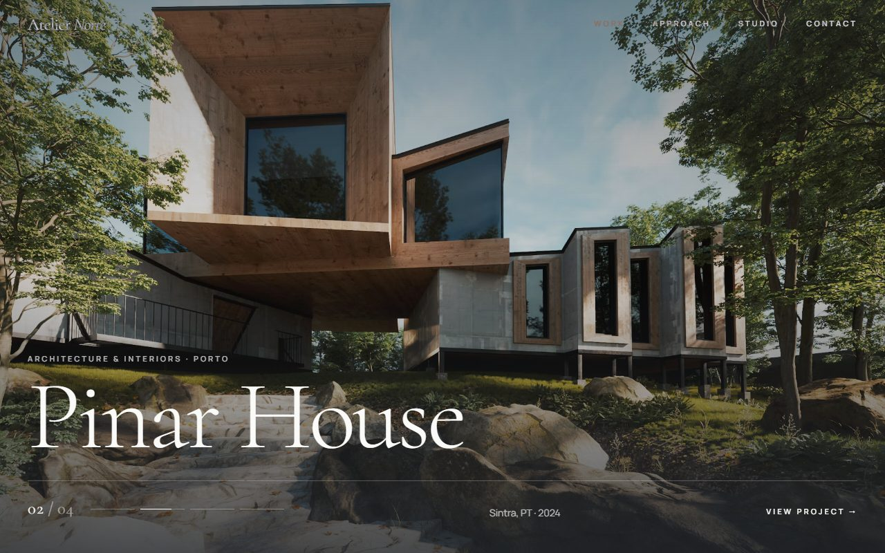

# Atelier Norte

**Architecture studio website** · a concept project by [Mayank Mehra](https://mayankmehra.pages.dev)

[](https://atelier-norte-djv.pages.dev)

**Live site:** https://atelier-norte-djv.pages.dev

## The brief

An architecture and interiors studio whose portfolio had to feel as considered as the buildings themselves.

## Signature moment

Photos that "melt" into each other with a noise-driven WebGL transition.

## What I built

- WebGL displacement slideshow
- Animated project filters (GSAP Flip)
- Image-expand and curtain page transitions
- 8 pre-rendered project pages with drag galleries and floor plans

## Tech

Nuxt · Vue · WebGL (Three.js) · GSAP Flip · Tailwind CSS · Lenis

## Run it locally

```bash
npm install
npm run dev       # http://localhost:3000
npm run generate  # static site in .output/public
```

---

More of my work: **[mayankmehra.pages.dev](https://mayankmehra.pages.dev)**
